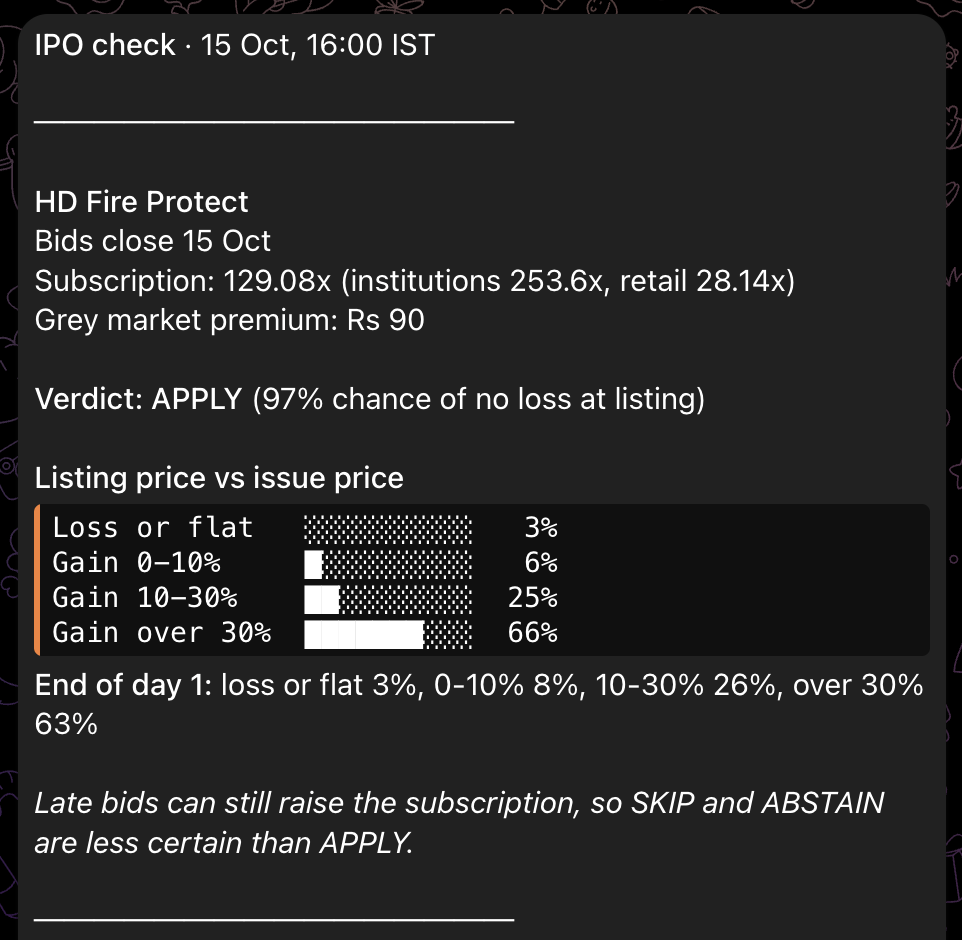

# ipo-agent

**Will this IPO list above its issue price? A small, free system that answers with odds, not opinions.**

It watches every Indian mainboard IPO while bids are open. On the last bidding day it sends a Telegram message with the chance of a loss, a small gain, a good gain or a big gain at listing, and one word: **APPLY**, **SKIP** or **ABSTAIN**. Every call is saved and later checked against what really happened.

> Personal research and engineering project. **Not investment advice**, not a registered advisory service.

<p align="center">
  
</p>

*The real alert for HD Fire Protect, sent at 16:00 IST on its last bidding day (15 Oct 2026). It listed on 21 Oct at **+23.6%**. The call held, though the most likely bucket (over 30%) did not: it landed in 10-30%.*

## At a glance

| | |
|---|---|
| Past IPOs it learned from | 457 mainboard IPOs, 2021 to Oct 2026 |
| When it said APPLY (backtest, 2023-2026) | **95.2%** did not lose at listing (145 IPOs, 95% confidence range 90-98%) |
| When it said SKIP | only 34% listed in profit (76 IPOs) |
| Live verdicts so far | 6 before bidding closed (since 15 Oct 2026). Both APPLY calls listed in profit: **+23.6%** and **+65.7%** |
| Live data collected | 54 snapshots, 643 price rows, 377 subscription rows (since 2 Oct 2026) |
| Running cost | ₹0 (GitHub Actions, a free timer, a Telegram bot) |

## New to IPOs? The 30-second version

- An **IPO** is a company selling shares to the public for the first time. You bid during a 3-day window and the shares start trading a few days later. That first trading price decides whether you made or lost money.
- **Subscription** is how many times over the shares were bid for. 100x means 100 times more demand than supply. It is the strongest signal this project found.
- Bids are split by investor type: **institutions** (mutual funds, insurers), **wealthy individuals** and **retail** (everyone else). Institutions often bid late and are watched closely.
- The **grey market premium (GMP)** is an unofficial price people quote before listing. Popular, but unofficial and easy to move.

## How it works

1. **Collect.** At 11:00, 14:00 and 16:00 IST on weekdays it reads public IPO tables: subscription (total and by investor type), valuation (P/E) and the grey market premium. Each snapshot is appended to a log and never overwritten.
2. **Estimate.** A small model, trained only on IPOs from before the one being judged, turns the final subscription level into probabilities for four outcomes: loss or flat, 0-10%, 10-30%, over 30%.
3. **Decide.** On the last bidding day, from 15:30 IST: **APPLY** if the chance of no loss is at least 90%, **SKIP** if under 50%, **ABSTAIN** in between. Earlier it only says "too early", because early numbers are not a fair guide.
4. **Keep score.** Every Saturday it collects the listing results, scores every verdict and sends a scorecard.

```
public IPO tables ──> snapshot job (3x a day) ──> append-only logs ──> model ──> Telegram verdict
                                                         │
listing results ───> weekly job ──> training history + scorecard ───────────> Telegram scorecard
```

No server and no database: GitHub Actions does the work, CSV files in this repo are the storage, and git history is the audit trail.

## Results

Tested the honest way: for each year from 2023 to 2026, the model was trained only on earlier years and then judged on that year (353 IPOs in total).

**Does the verdict separate good IPOs from bad ones?**

| Verdict | IPOs | Listed in profit | 95% range |
|---|---|---|---|
| APPLY | 145 | **95.2%** | 90-98% |
| ABSTAIN | 132 | 68.9% | 61-76% |
| SKIP | 76 | 34.2% | 25-45% |

**Are its percentages honest?** When it put the chance of a loss under 10%, losses happened 5% of the time (145 IPOs). When it put it above 50%, losses happened 66% of the time (76 IPOs). Its error score (Brier) is 0.622, against 0.759 for always guessing the average; lower is better.

**Year by year.** IPOs have become harder, which is why caution matters:

| Year | IPOs | Listed in profit | Median gain at listing |
|---|---|---|---|
| 2021 | 66 | 73% | +14.7% |
| 2022 | 38 | 71% | +5.1% |
| 2023 | 60 | 80% | +16.5% |
| 2024 | 93 | 77% | +15.6% |
| 2025 | 100 | 67% | +3.8% |
| 2026 (to Oct) | 100 | 68% | +6.9% |

In 2026 alone, APPLY calls did not lose 91.7% of the time (36 IPOs, range 78-97%). The model is conservative: it held back on 35 of the 68 IPOs that went on to list in profit.

**Live track record.** Only verdicts given before bidding closed count.

| IPO | Verdict | Listed | At open |
|---|---|---|---|
| HD Fire Protect | APPLY (97%) | 21 Oct 2026 | **+23.6%** |
| Fusion CX | SKIP (50%) | 22 Oct 2026 | +5.5% (a missed gain) |
| Tonbo Imaging India | APPLY (96%) | 23 Oct 2026 | **+65.7%** |
| Zetwerk | SKIP (45%) | 23 Oct 2026 | +5.5% (a missed gain) |
| Sahajanand Medical Technologies | ABSTAIN (63%) | 23 Oct 2026 | +7.9% |
| Bonfiglioli Transmissions | ABSTAIN (83%) | 23 Oct 2026 | 0.0% (flat) |

So far: both APPLY calls gained, and the two SKIPs missed small gains of about 5%, which fits its cautious design. Six calls prove very little yet. Results for 23 Oct are from Groww on listing day; [`data/scorecard.csv`](data/scorecard.csv) updates itself every Saturday.

## What I learned building it

- **My first model looked perfect, and it was cheating.** Using the grey market premium it scored 100% on 65 picks. The premium in my historical data had been recorded on listing morning, days after bidding closes, so it leaked the answer. I threw those results out and rebuilt on information that exists at decision time.
- **Simple beat complex.** Issue size, recent market mood and company financials read from the prospectus by an LLM did not improve out-of-sample results. The parked LLM experiment is kept in `src/prospectus.py` and `src/extract.py`.
- **The most popular signal has no free history.** So the system records the grey market premium itself, at the moments a decision is made, to test it properly later.
- **Cloud schedules are not punctual.** GitHub dropped or delayed scheduled runs by up to two hours, so an outside timer now starts them on time.

## Reliability and safety

- **Fails loudly.** Any failed step sends a Telegram alert with a link to the run. The outside timer separately alerts if it cannot start a run.
- **Guards against bad data.** A snapshot with an empty price table stops the run instead of saving nothing. The weekly job refuses to shrink the history if the source page suddenly returns fewer rows. Missing subscription data produces "no verdict", never a confident SKIP.
- **No stale calls.** A verdict is only built from data captured in the same run.
- **Locked-down automation.** Third-party actions are pinned to exact commits, Python packages to exact versions, every job has a 10-minute limit, and the bot can only write to this repository. Secrets live in GitHub's secret store, never in the code.
- **Polite collection.** Only sources whose robots.txt allows automated access are read, a few times a day.

## Run it yourself

Needs Python 3.9 or newer.

```bash
pip install -r requirements.txt
python3 src/build_dataset.py --fetch   # download past IPO results (2021 to now), build data/ipos.csv
python3 src/model.py                   # quick self-check
python3 src/evaluate.py                # walk-forward backtest, calibration, confidence ranges
python3 src/log_gmp.py                 # take one live snapshot
python3 src/predict.py | sed 's/<[^>]*>//g'   # message for IPOs whose bidding closes today (from 15:30 IST)
```

To run your own bot: fork the repo, add `TELEGRAM_BOT_TOKEN` and `TELEGRAM_CHAT_ID` as repository secrets, and point a free timer such as cron-job.org at the `gmp-snapshot` workflow's dispatch URL, using a fine-grained token limited to "Actions: read and write" on your fork.

## Project layout

| Path | What it does |
|---|---|
| `src/build_dataset.py` | Downloads and parses past IPO results |
| `src/model.py` | The model: subscription in, four outcome probabilities out |
| `src/evaluate.py` | Walk-forward backtest, calibration table, confidence ranges |
| `src/log_gmp.py` | Live snapshot of the public IPO tables |
| `src/predict.py` | Builds the Telegram message and records verdicts |
| `src/notify.py` | Sends messages to Telegram, splitting long ones safely |
| `src/update_data.py` | Weekly refresh of listing results |
| `src/scorecard.py` | Scores verdicts against real listings |
| `src/prospectus.py`, `src/extract.py` | Parked LLM experiment (reads offer documents) |
| `.github/workflows/` | Snapshot job and weekly job, with failure alerts |
| `data/` | Live logs, verdicts and scorecard, committed by the bot after every run |

## Limits

- It judges demand only, not the company's business or accounts.
- Late bids on the last day can still change the picture, so SKIP and ABSTAIN are less certain than APPLY.
- Even after an APPLY, retail allotment is often a lottery, and about one in twenty confident calls has still lost.
- Markets change. Past results may not hold.

## Disclaimer

For learning and research only. Nothing here is a recommendation to buy or sell any security, and this project is not registered with SEBI as an investment adviser or research analyst. Data comes from public sources and may be wrong or late. Make your own decisions.

## License

MIT. See [LICENSE](LICENSE).
